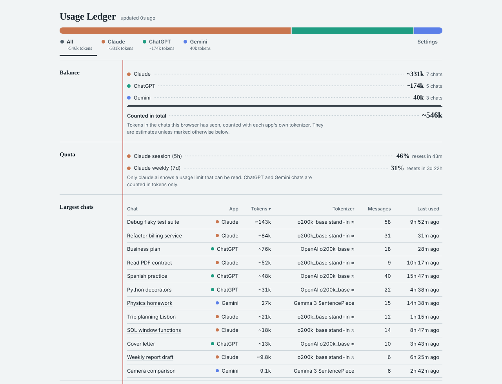
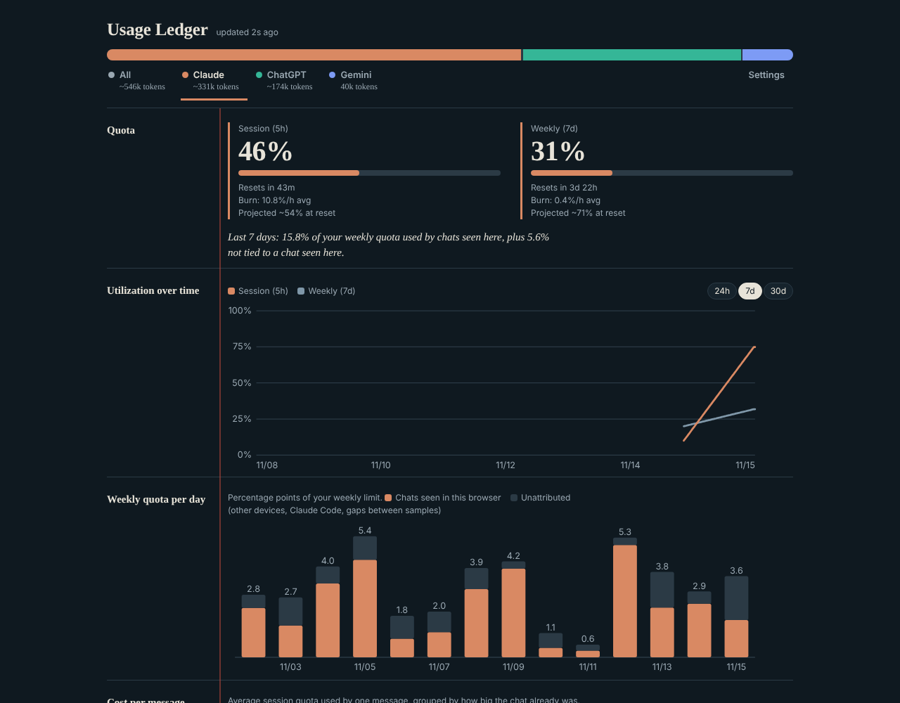
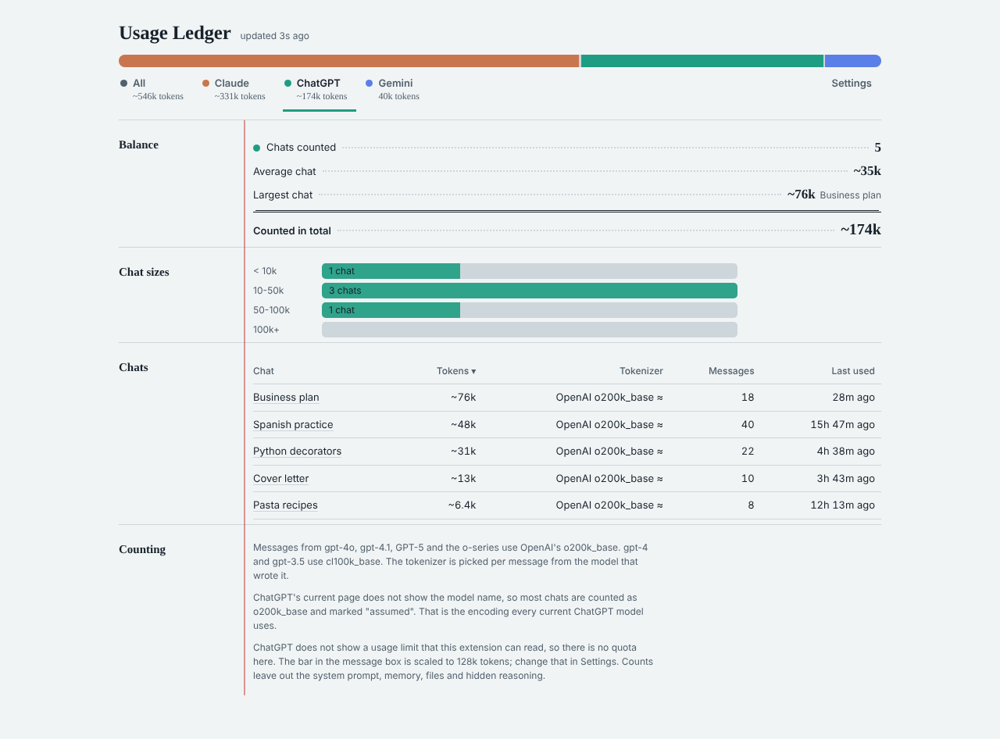
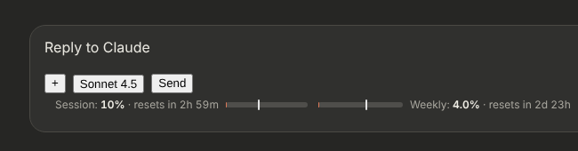
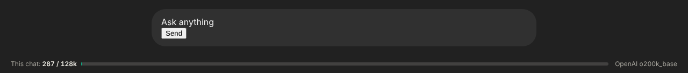
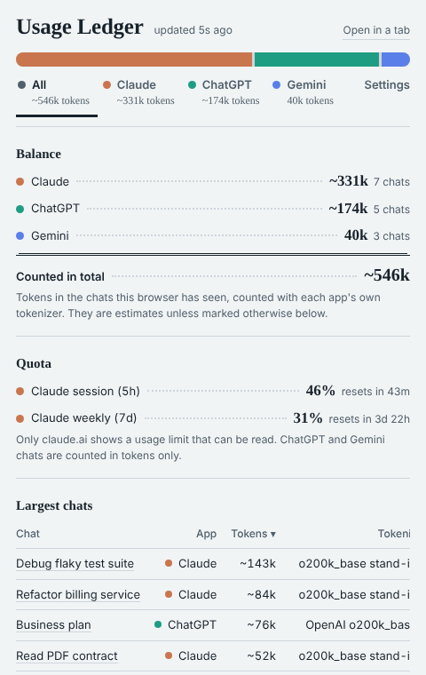
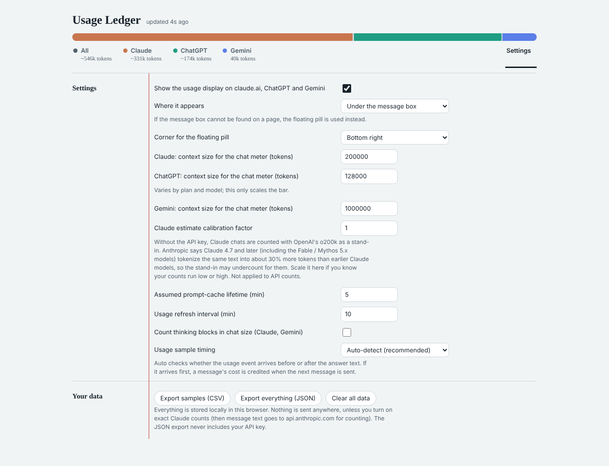

<div align="center">


# Usage Ledger

**Token counter and usage history for Claude, ChatGPT & Gemini.**


</div>

---

A Chromium extension (Chrome, Edge, Brave, Arc) that counts every chat's tokens **with the right tokenizer for the site and the model you picked**, shows a live usage bar attached to the message box, and gives you one dashboard for all three apps. On claude.ai it also keeps a history of your Session and Weekly limits, so you can see where they went.

> **Created by [Swapnil Bhange](https://github.com/swapnilbhange) with the help of [Claude](https://claude.ai) (Anthropic).**
> The goals, requirements, real-world testing and scope decisions were Swapnil's; Claude wrote and tested most of the code under his direction. See [How this was built](#how-this-was-built).

<p align="center">
  
</p>

*Dashboard screenshots use made-up sample data.*

---

## Contents

- [Why this exists](#why-this-exists)
- [Highlights](#highlights)
- [Screenshots](#screenshots)
- [Install](#install)
- [How tokens are counted](#how-tokens-are-counted)
- [Using it](#using-it)
- [Advantages](#advantages)
- [Limitations](#limitations-please-read)
- [Privacy](#privacy)
- [Roadmap](#roadmap)
- [Release notes](#release-notes)
- [Development](#development)
- [FAQ](#faq)
- [How this was built](#how-this-was-built)
- [Credits and licence](#credits-and-licence)

## Why this exists

Chat apps hide the numbers that matter: how big a chat has become, which model's tokenizer applies, and how fast you are burning a rate-limited plan. Two good open-source extensions, [claude-counter](https://github.com/she-llac/claude-counter) and [Claude Token Counter OG](https://github.com/jaggureddy11/CLAUDE-TOKEN-COUNTER-OG), cover Claude only. Usage Ledger takes the useful ideas from both (live token count, cache timer, usage bars) and extends them to ChatGPT and Gemini, with a tokenizer that follows the model and a local history.

## Highlights

- **Tokenizer follows the site and the model.** OpenAI chats use OpenAI's `o200k_base` or `cl100k_base`, Gemini chats use the Gemma 3 SentencePiece vocabulary, Claude chats use an estimate or, if you opt in, Anthropic's own `count_tokens` API. The choice is made **per message**, so switching models mid-chat is handled.
- **Usage bar inside the message box.** On claude.ai: Session and Weekly bars with a tick showing how far through each window you are. On ChatGPT and Gemini: this chat's size against a context-size bar. Falls back to a corner pill if the box cannot be found.
- **One dashboard, four tabs.** All, Claude, ChatGPT, Gemini (plus Settings). A bar at the top shows each app's share of what you have counted.
- **Honest labels.** Every number says which tokenizer produced it and whether it is exact, an estimate, or an assumption.
- **Claude usage history.** Session (5h) and Weekly (7d) windows, reset countdowns, burn-rate projection, cost per chat, cost per message by chat length, weekly quota spent per day.
- **Private by default.** No servers, no analytics, no accounts. Chat text is never stored, only token counts.
- **Tested.** Unit tests, the Gemma tokenizer checked piece-for-piece against Google's reference, and an end-to-end suite that loads the real extension in Chrome against mock pages.

## Screenshots

| | |
|---|---|
|  |  |
| **Claude tab** (dark): quota cards, usage over time, weekly quota per day, chats | **ChatGPT tab**: chats counted, average and largest chat, size histogram |
|  |  |
| **Bar under the message box (claude.ai layout)**: Session and Weekly with elapsed-time ticks | **Bar under the composer (ChatGPT layout)**: tokens against context size |
|  |  |
| **Toolbar popup**: the same dashboard at 480 px | **Settings**: placement, context sizes, calibration, export, clear |

The two message-box screenshots were taken on local test pages that imitate each site's markup, not on the live sites (see [Limitations](#limitations-please-read)).

## Install

**From the Chrome Web Store (recommended):** [Usage Ledger on the Chrome Web Store](https://chromewebstore.google.com/detail/usage-ledger/dfgnanojcdndnjcllgjaijdlkmapldan). Click *Add to Chrome*. The listing is currently unlisted, so use this link to find it.

You can also install it as an unpacked extension:

**From a release zip**
1. Download `usage-ledger-<version>.zip` from the [Releases](../../releases) page and unzip it.
2. Open `chrome://extensions` and switch on **Developer mode**.
3. Click **Load unpacked** and choose the **unzipped folder** (Chrome cannot load a `.zip` directly).

**From source**
```bash
git clone https://github.com/swapnilbhange/usage-ledger.git
cd usage-ledger
# then Load unpacked -> choose the extension/ folder
```

Open a chat on claude.ai, chatgpt.com or gemini.google.com. The usage bar appears under the message box within a few seconds. Requires Chrome 114 or newer (or a Chromium browser of the same age).

**Updating:** remove the old copy on `chrome://extensions`, then load the new folder. An unpacked extension's identity follows the folder it is loaded from, so loading from a different folder starts with empty history. Export first (Settings → Export) if it matters, or unzip the new version over the same folder.

### First-run check (2 minutes)
1. **claude.ai:** the bar under the message box shows Session and Weekly numbers. Send a message; the dashboard gets a new point, and after the next message the chat shows what it cost.
2. **chatgpt.com / gemini.google.com:** open an existing chat. The bar should show a token count within about 2 seconds and name the tokenizer. If it says it could not read the chat, click it and use **Copy diagnostics** (structure only, no message text) and open an issue.
3. **ChatGPT:** switch models mid-chat and watch the tokenizer line change.

## How tokens are counted

| You are on | Model selected | Tokenizer | Accuracy |
|---|---|---|---|
| chatgpt.com | gpt-4o, gpt-4.1, gpt-4.5, gpt-5.x, o1/o3/o4 | OpenAI `o200k_base` | exact |
| chatgpt.com | gpt-4, gpt-4-turbo, gpt-3.5 | OpenAI `cl100k_base` | exact |
| chatgpt.com | name not shown or not recognised | `o200k_base` assumed | estimate |
| gemini.google.com | gemini-2.x, gemini-3-pro / flash | Gemma 3 SentencePiece | exact if the model id is visible |
| gemini.google.com | "Fast", "Pro", gemini-3.1 / 3.5 | Gemma 3 SentencePiece | estimate |
| claude.ai | any | `o200k_base` stand-in × a calibration factor | estimate |
| claude.ai | any, **with your own API key** (opt in) | Anthropic `count_tokens`, using the chat's own model | near-exact |

Anthropic does not publish an offline tokenizer for current Claude models, so exact Claude counts need their API: you paste your own key, grant the `api.anthropic.com` permission, and each message is sent once for counting and cached. Leave it off and nothing leaves your browser. Details, model patterns and caveats are in [docs/TOKENIZERS.md](docs/TOKENIZERS.md).

## Using it

**The usage bar**
- claude.ai: *Session* and *Weekly* bars under the model row. The white tick on each bar marks how far through the 5-hour or 7-day window you are, so a fill ahead of the tick means you are spending faster than the window passes.
- ChatGPT / Gemini: the chat's tokens against a context-size bar, with the tokenizer named.
- Click the bar for details (reset countdowns, cost of this chat, cache timer, tokenizer). Click elsewhere or press `Esc` to close.
- Prefer the old corner pill? Settings → *Where it appears*.

**The dashboard** (toolbar icon for the popup, *Open in a tab* for the full page; tabs deep-link, for example `dashboard.html#chatgpt`)

| Tab | What is in it |
|---|---|
| **All** | Tokens per app with a total, the Claude quota, the largest chats across every site, the tokenizer-by-model table |
| **Claude** | Session / Weekly cards with burn rate and projection, usage over time (24h / 7d / 30d), weekly quota per day, cost per message by chat length, chats with their quota cost, the optional exact-count API setup |
| **ChatGPT** | Chats counted, average and largest chat, chat-size histogram, chat list, how ChatGPT is counted |
| **Gemini** | The same as ChatGPT, for Gemini |
| **Settings** | Placement, context sizes, Claude calibration, thinking blocks, usage timing, CSV and JSON export (never includes your API key), clear all data |

## Advantages

**Compared with Claude-only counters, Usage Ledger adds**

| | |
|---|---|
| Three sites, one tool | Claude, ChatGPT and Gemini in one extension and one dashboard |
| Model-aware tokenizing | Per message, so a chat that moves from gpt-4 to gpt-5 is counted correctly |
| Exact where exact is possible | OpenAI encodings are exact; the Gemini tokenizer is a verified port; Claude can use Anthropic's own endpoint |
| Honest about uncertainty | Every figure is labelled exact, estimate or assumed; unreadable pages say so instead of showing a made-up number |
| History, not just a snapshot | Samples, per-chat cost and per-day quota are kept locally and can be exported |
| Burn-rate projection | "At this pace you hit the limit in about 1h 10m, before the reset" |
| No data leaves the browser by default | Plus a structure-only diagnostics button for bug reports |
| Light on the page | One service worker does the counting once, not once per tab; the UI is a single shadow-DOM element |
| Maintainable | The model → tokenizer mapping and the site readers are small, separate, unit-tested modules |

**Practical benefits**
- See a chat getting too long before replies degrade or limits drain.
- Compare how the same text costs on different tokenizers.
- Find the chats that eat your weekly limit.
- Export samples to CSV or JSON for your own analysis.

## Limitations (please read)

This was built and tested in a sandbox without access to the three live sites, so several parts are **tested against mock pages only**. Treat the first release as a solid beta.

1. **Placement is a best guess on live sites.** On claude.ai the bar follows the same anchor idea as claude-counter (the toolbar row that holds the model picker). On ChatGPT and Gemini it goes right after the composer box. If the box is not found, the floating pill is used and *Copy diagnostics* names the anchor it found.
2. **ChatGPT and Gemini are read from the page's DOM.** The current ChatGPT layout was modelled on a structure outline taken from a real chat; the Gemini reader has only been tested on a mock. Both sites change their markup often. When a chat cannot be read you get an explicit message and a diagnostics button, not a wrong number. Selectors live in `extension/adapters.js`.
3. **ChatGPT does not show the model name** in its current layout, so chats are counted as `o200k_base` and labelled *assumed*. (Every current ChatGPT model uses that encoding.)
4. **Gemini model names are labels, not ids** ("Fast", "Pro"), and the newer 3.1 / 3.5 models use a vocabulary that is not bundled, so Gemini counts are usually labelled estimates.
5. **Claude counts are estimates by default.** The `o200k_base` stand-in can undercount for Claude 4.7+ and the Fable / Mythos 5.x models, which Anthropic says produce about 30% more tokens. Use the calibration factor, or the API option.
6. **The Claude API mode has not been run against the live API** (no key was available while building). It is tested against a mock of `count_tokens`. Counting is per message, with measured wrapper overhead subtracted, so small differences from a whole-conversation count are possible.
7. **claude.ai internals are undocumented.** The `/usage` endpoint, the `message_limit` stream event and the conversation payload can change without notice and have been tested only against a mock. This extension only reads data your own logged-in session can already see.
8. **Counts leave things out:** system prompts, memory, project knowledge, files and images, each provider's per-message framing tokens, and hidden reasoning (unless you enable thinking blocks for Claude / Gemini).
9. **Quota attribution is approximate.** The change in utilisation is credited to the message that was just sent. Usage from other clients (the mobile app, Claude Code) shows up as *unattributed*. The prompt-cache lifetime is an assumption (5 minutes by default).
10. **Window usage is only recorded while a claude.ai tab is open.**
11. **ChatGPT and Gemini have no readable quota**, so they get token counts only. No quota numbers are invented for them.
12. **Chromium only.** Firefox and Safari are not supported (see the roadmap).
13. **Not on a store.** You install it unpacked, and Chrome may show a developer-mode warning.
14. **Terms of service.** This is an unofficial tool that reads pages and endpoints you already use. Check each service's terms and use it at your own risk.

## Privacy

- Permissions: `storage`; content scripts on claude.ai, chatgpt.com and gemini.google.com; and an *optional* `api.anthropic.com` permission that is only requested if you turn on exact Claude counts.
- By default the only network calls are same-origin requests to claude.ai made with your own session.
- Stored in `chrome.storage.local`: token counts per message, chat titles, usage numbers, settings. **Chat text is not stored.**
- Your API key, if you add one, is stored locally, excluded from exports, and only ever sent to `api.anthropic.com`. When exact counting is on, the text of chat messages is sent to Anthropic for counting; leave it off if you would rather not.

Full details: [PRIVACY.md](PRIVACY.md). Security reports: [SECURITY.md](SECURITY.md).

## Roadmap

The short version (the full list, with what is not planned, is in [ROADMAP.md](ROADMAP.md)):

- **0.3.x:** verify and fix placement and readers on the live sites, using real diagnostics from users.
- **0.4:** token history over time for ChatGPT and Gemini, threshold alerts, a standalone options page, CSV export of chats.
- **0.5:** bundled Gemma 4 vocabulary when the newer Gemini models are confirmed to use it, Edge and Brave smoke tests.
- **Later:** Firefox, more sites, per-project totals.

## Release notes

**v0.3.1**: the details panel opens on top of the message box instead of behind it. **v0.3.0**: inline usage bar in the message box, tabbed dashboard (All / Claude / ChatGPT / Gemini), new ledger-style layout, deep links, panel closes on outside click and Esc.
Every version, with details, is in [CHANGELOG.md](CHANGELOG.md).

## Development

```bash
npm install            # jsdom (adapter tests) and playwright (e2e)
npm test               # unit tests: node --test tests/*.test.js
npm run e2e            # loads the real extension in Chrome against mock sites
npm run pack           # dist/usage-ledger-<version>.zip
npm run store          # Chrome Web Store images in store/
```

The e2e suite needs a Chrome or Chromium binary (`CHROME_PATH=/path/to/chrome npm run e2e`) and `openssl` for the throwaway test certificate. See [CONTRIBUTING.md](CONTRIBUTING.md) and [docs/ARCHITECTURE.md](docs/ARCHITECTURE.md) for how the pieces fit together, and for how to add a site or a model.

```
extension/   the extension (this folder is what Chrome loads)
tests/       unit tests, tokenizer golden data
e2e/         mock claude.ai / chatgpt.com / gemini and the Playwright suite
tools/       rebuilds the Gemma vocabulary file
scripts/     version check and zip packaging
store/       Chrome Web Store images and the script that builds them
docs/        architecture, tokenizer notes, screenshots, release notes
```

## FAQ

**Is this official?** No. It is an independent project and is not affiliated with Anthropic, OpenAI or Google.

**Does it send my chats anywhere?** No, unless you turn on exact Claude counts, in which case each message's text is sent once to Anthropic's `count_tokens` endpoint using your own key.

**Why does ChatGPT show "assumed"?** The page does not expose which model wrote a reply. The encoding is the same for all current ChatGPT models, so the number is still right in practice, but the label stays honest.

**Why are Claude numbers marked as estimates?** There is no public offline Claude tokenizer. Enable the API option for near-exact counts.

**The bar is floating in a corner instead of under the message box.** The page layout was not recognised. It still works; please open an issue with the output of *Copy diagnostics*.

**It says it could not read this chat.** The site's markup probably changed. *Copy diagnostics* copies the page structure (tags, attributes, text lengths, never the text) for a bug report.

**Does it work in Firefox / Safari?** Not yet.

## How this was built

Usage Ledger was created by **Swapnil Bhange** in a long working session with **Claude**. The process:

1. Swapnil asked Claude to analyse two existing open-source Claude token counters and list their weaknesses.
2. He then asked for one tool that tracks his own usage better, then for automatic tokenizer switching by site and model, then for the Claude token-counting documentation to be read and applied.
3. Real-world testing by Swapnil on ChatGPT found a layout the first version could not read; his console output was used to fix it.
4. His design requests (the bar inside the message box, the four-tab dashboard, a more distinctive layout) produced v0.3.0.

Claude wrote and tested the code, including a JavaScript port of the Gemma SentencePiece tokenizer verified against the reference implementation. Swapnil set the goals, supplied real page structures, tested on his own machine and made the calls on scope. The limitations above are stated plainly because most of the live-site behaviour could only be tested on mock pages.

## Credits and licence

- **Created by Swapnil Bhange with the help of Claude (Anthropic).**
- Design references: [claude-counter](https://github.com/she-llac/claude-counter) and [Claude Token Counter OG](https://github.com/jaggureddy11/CLAUDE-TOKEN-COUNTER-OG) (both MIT). claude.ai's API shapes were learned from claude-counter, which credits [Claude Usage Tracker](https://github.com/lugia19/Claude-Usage-Extension). No code from either is included.
- Tokenizers: [gpt-tokenizer](https://github.com/niieani/gpt-tokenizer) (MIT, vendored); Gemma 3 vocabulary from Google, see [THIRD_PARTY_NOTICES.md](THIRD_PARTY_NOTICES.md) and [NOTICE](NOTICE).

Released under the [MIT licence](LICENSE).

---
Usage Ledger is an independent project and is not affiliated with, endorsed by or sponsored by Anthropic, OpenAI or Google. Claude, ChatGPT and Gemini are trademarks of their respective owners and are used here only to say which sites the extension works with.
