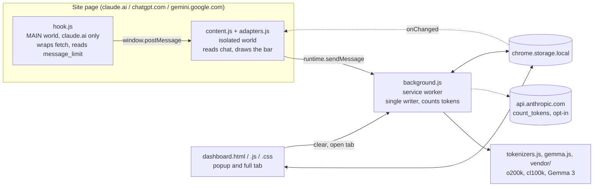

# Architecture

Usage Ledger is a Manifest V3 extension with no build step: every file in `extension/` is loaded as written.

## Files

| File | Runs in | Job |
|---|---|---|
| `hook.js` | claude.ai page (MAIN world) | Wraps `fetch`, watches completion requests and `message_limit` stream events. Stores nothing. |
| `content.js` | all three sites (isolated world) | claude.ai: fetches the chat and `/usage` with your own session. Others: reads the visible conversation through `adapters.js`. Draws the inline bar or corner pill in a shadow DOM. |
| `adapters.js` | content script | Pure DOM readers for ChatGPT and Gemini, `findAnchor` (where to put the bar), `diagnose` (structure-only report). Unit-tested with jsdom. |
| `providers.js` | everywhere | Site detection and the model → tokenizer mapping. Pure functions. |
| `tokenizers.js` | service worker | Registry: picks a counter for a tokenizer spec, handles fallbacks and the Claude API client. |
| `gemma.js` | service worker | JavaScript port of the SentencePiece BPE encoder for the Gemma 3 vocabulary. |
| `background.js` | service worker | The only writer to storage. Counts tokens once per changed message, attributes quota changes to chats, validates every incoming message. |
| `core.js` | everywhere | Shared helpers: settings defaults, window maths, burn-rate projection, formatting, hashing. |
| `dashboard.*` | popup and tab | Plain DOM and SVG, no libraries. Tabs are driven by `location.hash`. |

## Data flow

**claude.ai.** `hook.js` sees a completion request start and end and any `message_limit` event, and posts it to `content.js`. `content.js` forwards events to the service worker and, after a send, fetches the conversation tree. The worker counts changed messages, stores token counts and a usage sample, and credits the change in utilisation to that chat. A periodic `/usage` poll, made by `content.js` with your own session, covers times when nothing is being sent.

**ChatGPT and Gemini.** `content.js` watches the page with a `MutationObserver`, asks `adapters.js` to read the conversation, and sends message ids, text and model hints to the worker. The worker counts each message with the tokenizer chosen for it and keeps only a hash and a count. If nothing can be read for about eight seconds the bar shows the "couldn't read this chat" state.

**Storage layout (`chrome.storage.local`).**

| Key | Contents |
|---|---|
| `settings` | user settings merged over `DEFAULT_SETTINGS` |
| `live` | latest usage windows (Session, Weekly) |
| `samples` | usage readings over time |
| `convs` | per chat: provider, title, tokens, tokenizer, message count, quota spent |
| `daily` | per-day quota spent and unattributed |
| `tok:<chatId>` | `{messageId: [hash, tokens, tokenizerId]}` cache |
| `anthropicKey` | only if exact counting is on; never exported |

## Where the bar goes

`AD.findAnchor(provider, document)` returns `{el, where:'after', kind}` or `null`.
- claude.ai: the element `[data-testid="model-selector-dropdown"]`, then up to the flex row of buttons that contains it; the bar is inserted after that row.
- ChatGPT / Gemini: the visible editable area (`#prompt-textarea`, `rich-textarea .ql-editor`, `div.ProseMirror`, `[contenteditable][role=textbox]`, `textarea`), then its composer card (a `form`, `input-area-v2`, `[data-testid*=composer]`, or the nearest ancestor with a border radius of 12px or more); the bar is inserted after it.
- If `null`, or if the setting says floating, the host element is appended to `<body>` as a corner pill. A one-second tick re-places the host if the page's framework removes it.

## Security and robustness choices

- No `innerHTML` anywhere; everything is `createElement` / `textContent`, which works under Trusted Types and strict CSPs. The end-to-end suite runs against mock pages that enforce both.
- The service worker validates the shape of every message it receives from a page (provider, ids, model strings) before using it.
- Everything the UI shows about accuracy comes from the same `specFor` function that chose the tokenizer.

## Tests

| Suite | What it covers |
|---|---|
| `tests/unit.test.js` | Parsing, attribution, projection, the hook, the service worker with fakes, per-message tokenizer switching, the Claude API client, dashboard/HTML consistency |
| `tests/gemma.test.js`, `gemma.golden.json` | Gemma tokenizer against reference output |
| `tests/tokenizers.test.js` | Model → tokenizer mapping, registry, fallbacks |
| `tests/adapters.test.js` | ChatGPT and Gemini readers, the current ChatGPT layout, diagnostics, anchors (jsdom) |
| `e2e/run.js` | Real Chrome with the extension loaded, against mock claude.ai, chatgpt.com and gemini.google.com served over HTTPS with a strict CSP |

## Extending

**Add a model:** edit `providers.js` and its tests. See [TOKENIZERS.md](TOKENIZERS.md).

**Add a site:**
1. Add the host to `detect` in `providers.js` and to `content_scripts.matches` in `manifest.json`.
2. Write a reader in `adapters.js` that returns `{id, name, model, msgs: [{id, role, text, model, ts}]}` for that site (see `readConversation`), and a `findAnchor` branch.
3. Add a mock page to `e2e/server.js` and tests to `tests/adapters.test.js`.
4. Add the site to the dashboard (`APPS`, `TABS`, and a panel in `dashboard.html`).
